# Car Dealership Inventory System

A full-stack inventory system for a car dealership, built test-first with Express, PostgreSQL and React.

Customers sign up, browse the showroom, search and filter it, and buy cars. Admins also add, edit, restock and delete vehicles. Every stock change happens in one atomic database statement, so two buyers can never get the last car. A test fires five buyers at a single unit at once to prove it.

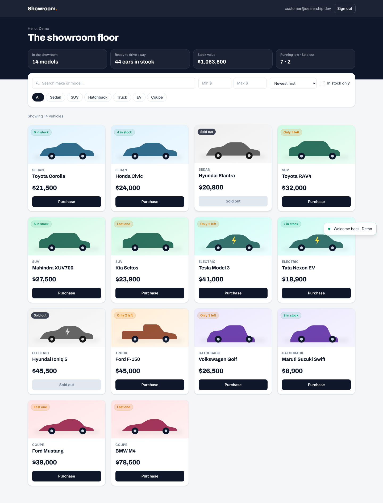

---

## Contents

- [Status](#status)
- [Features](#features)
- [Technology stack](#technology-stack)
- [Architecture](#architecture)
- [Getting started](#getting-started)
- [Environment variables](#environment-variables)
- [API reference](#api-reference)
- [Design decisions and interpretations](#design-decisions-and-interpretations)
- [Concurrency: selling the last car exactly once](#concurrency-selling-the-last-car-exactly-once)
- [Security](#security)
- [Testing and the TDD workflow](#testing-and-the-tdd-workflow)
- [Screenshots](#screenshots)
- [Deployment](#deployment)
- [Known limitations and future work](#known-limitations-and-future-work)

---

## Status

| Check | Result |
|---|---|
| Backend tests (Jest + Supertest against real PostgreSQL) | **99 passed**, 0 failed |
| Backend coverage | **98.2%** statements, 94.4% branches, 100% functions |
| Frontend tests (Vitest + React Testing Library + MSW) | **44 passed**, 0 failed |
| Frontend coverage | **91.3%** statements |
| Frontend lint (oxlint) | 0 errors |
| Production builds (API and SPA) | succeed |

Measured on 2026-10-25. The full output is in [TEST_REPORT.md](TEST_REPORT.md).

---

## Features

**Accounts and authentication**
- Register and sign in with an email and password. Emails are trimmed and lower-cased, so `Asha@Example.com` and `asha@example.com` are the same account.
- Passwords are hashed with bcrypt and never appear in any response.
- Stateless JWT authentication. The signing algorithm is pinned, tokens expire, and an expired session signs the user out with a friendly message.
- Sign-up can never create an admin, because the API never reads a `role` field from the request.
- Login is rate-limited, and failed logins never reveal whether an email is registered.

**Showroom (all signed-in users)**
- A live grid of every vehicle, with stock badges: *9 in stock*, *Only 2 left*, *Last one*, *Sold out*.
- Server-side search: free text across make and model, category chips, a price range, an in-stock toggle, and sorting by newest or price. Filters combine, and typing is debounced.
- A summary strip computed from live data: models on the floor, cars in stock, total stock value, and running-low and sold-out counts.
- One-click purchase. The button is disabled at zero stock, and if someone else buys the last unit first, the buyer is told so.

**Administration**
- Add and edit vehicles in a validated form. The form mirrors the API rules and shows server field errors next to the right input.
- Restock by any whole amount from 1 to 10,000, with a preview of the new stock level.
- Delete after a confirmation dialog.
- All of this is enforced by the API, not just hidden in the UI.

**Experience**
- Responsive from a 390 px phone to a wide desktop, with no horizontal scrolling.
- Loading skeletons, empty states with a *Clear filters* action, an error state with *Try again*, and toast notifications.
- Accessible dialogs: they are labelled, close on Escape or a backdrop click, and return focus to the button that opened them. Form fields have proper labels and `aria-invalid`.
- Every card gets per-category car artwork drawn in SVG, so there are no broken images and no image hosting.
- Demo account buttons on the sign-in page let reviewers get in with one click.

---

## Technology stack

| Layer | Choice | Why |
|---|---|---|
| API | **Node 22, Express 5, TypeScript 5.9** | Express 5 forwards errors from async handlers on its own, so there's no wrapper boilerplate. |
| Validation | **Zod 4** | One schema validates, coerces and types each request. |
| Database | **PostgreSQL 16** with **Prisma 7** (pg driver adapter) | Real transactions, `CHECK` constraints and row locking for stock. Prisma gives typed queries with bound parameters. |
| Auth | **jsonwebtoken** (HS256, pinned), **bcryptjs** | Stateless tokens; bcrypt with a configurable cost. |
| Hardening | **helmet**, **express-rate-limit**, CORS allow-list, 10 kB body limit | Cheap, standard controls (see [SECURITY.md](SECURITY.md)). |
| Frontend | **React 19, Vite 8, Tailwind CSS 4, TanStack Query 5, React Router 8, React Hook Form** | Server state is cached and refetched after every change. Design tokens live in one `@theme` block. |
| Backend tests | **Jest 29, ts-jest, Supertest** | Integration tests drive the real Express app against a real test database. |
| Frontend tests | **Vitest 5, React Testing Library, MSW 3** | Components are tested the way users use them. MSW fails any request a test didn't expect. |
| Hosting | **Neon** (Postgres), **Render** (API), **Vercel** (SPA) | All have free tiers. Config is in [`render.yaml`](render.yaml) and [`frontend/vercel.json`](frontend/vercel.json). |

---

## Architecture

```text
car-dealership-inventory/
├── backend/
│   ├── prisma/
│   │   ├── schema.prisma            users, vehicles, Role and Category enums
│   │   ├── migrations/              SQL migrations (incl. hand-written CHECK constraints)
│   │   └── seed.ts                  admin, demo customer, 14-car showroom (idempotent)
│   ├── src/
│   │   ├── server.ts                starts the HTTP server
│   │   ├── app.ts                   Express app: helmet, CORS, body limit, routers, errors
│   │   ├── container.ts             composition root: builds and wires every dependency
│   │   ├── config/env.ts            validates environment variables at startup
│   │   ├── db/                      Prisma client factory, Prisma error mapping
│   │   ├── security/                PasswordHasher (bcrypt), TokenService (JWT)
│   │   ├── middleware/              authenticate, requireRole, validate, rateLimit, errorHandler
│   │   ├── shared/errors.ts         AppError hierarchy (400/401/403/404/409)
│   │   └── modules/
│   │       ├── auth/                routes · controller · service · schemas
│   │       ├── users/               repository · types
│   │       ├── vehicles/            routes · controller · service · repository · schemas · types
│   │       └── inventory/           purchase and restock: routes · controller · service · repository
│   └── tests/
│       ├── unit/                    services with in-memory fakes, validation, env, rate limit
│       ├── integration/             HTTP tests through the whole stack, real database
│       ├── security/                JWT attack cases against a real middleware pipeline
│       └── helpers/, setup/         test app, fixtures, migrations, DB isolation
├── frontend/
│   └── src/
│       ├── lib/                     API client, session storage, formatting, shared types
│       ├── components/              UI primitives, Modal, Toast, Layout
│       ├── features/
│       │   ├── auth/                AuthContext, login and register pages, ProtectedRoute
│       │   ├── vehicles/            dashboard, filter bar, cards, stats strip, car artwork
│       │   ├── inventory/           purchase button and stock mutations
│       │   └── admin/               add/edit form, restock and delete dialogs
│       └── test/                    MSW server, render helper, fixtures
├── docs/screenshots/
├── render.yaml                      Render blueprint for the API
├── SECURITY.md                      threats, controls and the tests that prove them
└── TEST_REPORT.md                   full test and coverage output
```

### How a request flows

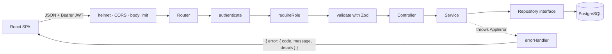

- **Controllers** only translate HTTP to service calls and back.
- **Services** hold the business rules ("sold out is a 409") and depend on repository **interfaces**, not on Prisma. That's why the unit tests can swap in in-memory fakes (`tests/unit/*.service.test.ts`).
- **Repositories** are the only code that talks to Prisma, and they translate database errors into domain errors. For example, a unique-email violation becomes `409 EMAIL_TAKEN` instead of a 500.
- **`container.ts`** is the single place where implementations are chosen and wired together (dependency injection by hand, no framework).
- On the frontend, each **feature folder** owns its pages, components, API calls and hooks. Shared pieces live in `lib/` and `components/`.

---

## Getting started

### Prerequisites

| Software | Version used |
|---|---|
| Node.js | 22.22 (20+ works) |
| npm | 10.9 |
| PostgreSQL | 16 (local install, Docker, or a free [Neon](https://neon.tech) project) |

### 1. Create two databases

The test suite **wipes its database on every run**, so it needs its own.

```sql
CREATE DATABASE dealership;
CREATE DATABASE dealership_test;
```

With Neon, create one project with two databases (`dealership` and `dealership_test`) and copy the pooled connection string for each.

### 2. Backend

```bash
cd backend
cp .env.example .env          # Windows PowerShell: Copy-Item .env.example .env
```

Edit `.env`. At a minimum, set `DATABASE_URL`, `TEST_DATABASE_URL`, `JWT_SECRET` and the admin seed credentials. To generate a strong secret:

```bash
node -e "console.log(require('crypto').randomBytes(48).toString('base64url'))"
```

Then install, migrate, seed and run:

```bash
npm install                   # also generates the Prisma client
npx prisma migrate deploy     # creates the tables and CHECK constraints
npm run db:seed               # admin + optional demo customer + 14 vehicles
npm run dev                   # http://localhost:4000/api/health → {"status":"ok"}
```

The seed is safe to re-run. It upserts the users and only adds vehicles when the table is empty.

### 3. Frontend

```bash
cd frontend
cp .env.example .env.local    # VITE_API_URL defaults to http://localhost:4000/api
npm install
npm run dev                   # http://localhost:5173
```

To show the one-click demo buttons locally, put the seeded demo credentials in the `VITE_DEMO_*` variables of `.env.local`.

### 4. Run the tests

```bash
cd backend  && npm test              # or npm run test:coverage
cd frontend && npm run test:run      # or npm run coverage
```

---

## Environment variables

**Backend** (`backend/.env`, all validated at startup by `src/config/env.ts`; the server refuses to start if one is invalid):

| Variable | Required | Default | Purpose |
|---|---|---|---|
| `DATABASE_URL` | yes | | PostgreSQL connection string |
| `TEST_DATABASE_URL` | for tests | | Separate database, wiped by the test run |
| `JWT_SECRET` | yes | | At least 32 characters |
| `JWT_EXPIRES_IN` | | `1d` | Token lifetime |
| `BCRYPT_COST` | | `10` | bcrypt work factor (tests use 4) |
| `CORS_ORIGIN` | | `http://localhost:5173` | Comma-separated list of allowed frontend origins |
| `LOGIN_RATE_LIMIT` / `LOGIN_RATE_WINDOW_MS` | | `10` / `900000` | Login attempts per IP per window |
| `PORT` | | `4000` | HTTP port |
| `ADMIN_EMAIL` / `ADMIN_PASSWORD` | for seeding | | First admin account |
| `DEMO_USER_EMAIL` / `DEMO_USER_PASSWORD` | | | Optional demo customer |

**Frontend** (`frontend/.env.local`). Everything here is compiled into the public bundle, so it must never hold a secret:

| Variable | Purpose |
|---|---|
| `VITE_API_URL` | API base URL including `/api` |
| `VITE_DEMO_*` | Optional demo-login buttons (demo accounts only) |

---

## API reference

Base URL: `/api`. All bodies are JSON. Protected routes need `Authorization: Bearer <token>`.

| Method | Path | Who | Success | Errors |
|---|---|---|---|---|
| `GET` | `/health` | anyone | 200 | |
| `POST` | `/auth/register` | anyone | 201 `{ token, user }` | 400, 409 `EMAIL_TAKEN` |
| `POST` | `/auth/login` | anyone (rate-limited) | 200 `{ token, user }` | 400, 401, 429 |
| `GET` | `/vehicles` | signed in | 200 `Vehicle[]`, newest first | 401 |
| `GET` | `/vehicles/search` | signed in | 200 `Vehicle[]` | 400, 401 |
| `GET` | `/vehicles/:id` | signed in | 200 `Vehicle` | 400, 401, 404 |
| `POST` | `/vehicles` | **admin** | 201 `Vehicle` | 400, 401, 403 |
| `PUT` | `/vehicles/:id` | **admin** | 200 `Vehicle` | 400, 401, 403, 404 |
| `DELETE` | `/vehicles/:id` | **admin** | 204 | 401, 403, 404 |
| `POST` | `/vehicles/:id/purchase` | signed in | 200 `Vehicle` (quantity − 1) | 401, 404, 409 `OUT_OF_STOCK` |
| `POST` | `/vehicles/:id/restock` | **admin** | 200 `Vehicle` (quantity + amount) | 400, 401, 403, 404 |

### Shapes

```jsonc
// Vehicle
{
  "id": "6e18356a-2cfb-4651-a2dd-7dfe3f3822a5",
  "make": "Toyota",
  "model": "Corolla",
  "category": "SEDAN",          // SEDAN | SUV | HATCHBACK | TRUCK | EV | COUPE
  "price": 21500,               // number in JSON, DECIMAL(12,2) in the database
  "quantity": 4,
  "createdAt": "2026-10-25T13:38:15.382Z",
  "updatedAt": "2026-10-25T13:38:15.382Z"
}

// Every error
{ "error": { "code": "VALIDATION_ERROR", "message": "Invalid request",
             "details": [{ "field": "price", "message": "Price must be greater than 0" }] } }
```

### Validation rules

| Field | Rule |
|---|---|
| `name` | 1 to 80 characters |
| `email` | valid email, trimmed and lower-cased |
| `password` | 8 to 72 characters (72 is bcrypt's input limit, so longer passwords are rejected rather than silently truncated) |
| `make`, `model` | 1 to 60 characters after trimming |
| `category` | one of the six enum values |
| `price` | greater than 0, at most 2 decimal places |
| `quantity` | whole number, 0 to 100,000 (defaults to 0) |
| `amount` (restock) | whole number, 1 to 10,000 |

Unknown fields such as `id`, `role` or `createdAt` are dropped before they reach a service.

### Search parameters

`GET /api/vehicles/search` accepts any combination of these (combined with AND):

| Parameter | Example | Meaning |
|---|---|---|
| `q` | `q=civ` | make **or** model contains the text (case-insensitive) |
| `make` | `make=toy` | make contains the text |
| `model` | `model=model 3` | model contains the text |
| `category` | `category=SUV` | exact category |
| `minPrice` / `maxPrice` | `minPrice=20000&maxPrice=40000` | inclusive range; either side may be omitted; `minPrice > maxPrice` is a 400 |
| `inStock` | `inStock=true` | only vehicles with stock |
| `sort` | `price_asc`, `price_desc`, `newest` | default `newest` |

### Try it with curl

```bash
API=http://localhost:4000/api
TOKEN=$(curl -s -X POST $API/auth/login -H 'Content-Type: application/json' \
  -d '{"email":"admin@dealership.dev","password":"<your ADMIN_PASSWORD>"}' | node -pe 'JSON.parse(require("fs").readFileSync(0)).token')

curl -s "$API/vehicles/search?category=EV&maxPrice=45000" -H "Authorization: Bearer $TOKEN"
curl -s -X POST $API/vehicles -H "Authorization: Bearer $TOKEN" -H 'Content-Type: application/json' \
  -d '{"make":"Porsche","model":"Taycan","category":"EV","price":89990,"quantity":2}'
```

---

## Design decisions and interpretations

- **Who can update a vehicle.** The brief marks only DELETE and restock as "Admin only", but it also puts the add, update and delete forms under "For Admin Users". I read that as: catalogue writes (create, update, delete, restock) are admin-only, and purchase is open to every signed-in user. Letting customers edit prices would make no sense for a dealership.
- **Reading the inventory requires sign-in.** The brief lists the vehicle endpoints as *Protected*, so all of them need a valid token.
- **Money is `DECIMAL(12,2)`, never a float.** The API returns it as a JSON number and rejects more than two decimal places.
- **Fixed categories.** An enum keeps search and filtering exact and prevents typos like "Suv" and "SUV" splitting the catalogue.
- **The register response includes a token**, so a new user lands in the showroom without signing in again.
- **Plain list vs search.** With no filters the UI calls `GET /vehicles`, and with any filter it calls `GET /vehicles/search`, so both endpoints from the brief are exercised.
- **Hand-written dependency injection** in `container.ts` instead of a DI framework. It's one readable file, and it's why every service can be unit-tested with fakes.

---

## Concurrency: selling the last car exactly once

A naive purchase reads the stock, checks it, then writes `quantity - 1`. Two buyers can both read `1` and both succeed, leaving the dealership with −1 cars.

This app instead runs one conditional statement:

```sql
UPDATE vehicles SET quantity = quantity - 1
WHERE id = $1 AND quantity > 0;     -- via Prisma updateMany
```

PostgreSQL locks the row while it updates. The second buyer then re-checks `quantity > 0`, finds it false, and updates 0 rows. The service maps "0 rows" to `404` if the vehicle doesn't exist, or to `409 OUT_OF_STOCK` if it does. A `CHECK (quantity >= 0)` constraint backs this up at the database level.

`inventory.test.ts` fires **five purchases of the last unit at once** and asserts exactly one `200`, four `409`s and a final stock of `0`. Restocks use `quantity = quantity + n` in SQL for the same reason, and a test runs four restocks at once to check that none are lost.

---

## Security

Security was part of the design from the start. [SECURITY.md](SECURITY.md) maps each threat to its control and to the test that proves it. Highlights:

- **JWT attack tests** (`tests/security/jwt-attacks.test.ts`): forged secret, tampered payload, `alg: none`, HS512 algorithm switch, expired token and garbage token all get 401. A customer token on an admin route gets 403.
- **No privilege escalation at sign-up**: a mass-assigned `"role": "ADMIN"` is ignored.
- **No account enumeration**: one generic 401, with timing equalised against a dummy bcrypt hash.
- **Login rate limiting**, a body size limit, helmet headers and a CORS allow-list.
- **Search input** has LIKE wildcards escaped. A test found that Prisma's `contains` doesn't do this.
- **Secrets** stay out of git. Production secrets are set in the hosting dashboards.

---

## Testing and the TDD workflow

Development followed red, green, refactor, and the commit history shows it. Each backend endpoint has a `test:` commit with its failing tests (marked *red*), followed by a `feat:` commit that makes them pass:

```text
test: user registration (red)                      → feat: implement user registration with bcrypt and JWT
test: login and login rate limiting (red)          → feat: implement login with rate limiting
test: JWT guards and token attack cases (red)      → feat: add authenticate and requireRole middleware
test: vehicle CRUD with admin-only writes (red)    → feat: implement vehicle CRUD endpoints
test: vehicle search by make, model, ... (red)     → feat: implement vehicle search with combinable filters
test: purchase and restock, ... race (red)         → feat: implement atomic purchase and admin restock
```

The frontend followed the same pattern for the API client, auth pages, showroom and admin flows.

**What the tests cover**

| Layer | Approach |
|---|---|
| Backend integration (`tests/integration`) | Supertest drives the real Express app against a real PostgreSQL test database: status codes, bodies, database side effects, access rules and race conditions. |
| Backend security (`tests/security`) | Hostile tokens against a real `authenticate → requireRole` pipeline. |
| Backend unit (`tests/unit`) | Services against in-memory fakes, the validation middleware, env validation and the rate limiter. |
| Frontend (`src/**/*.test.tsx`) | React Testing Library queries by role and label, as a user would. MSW mocks the API and fails on any unexpected request. Covers login, register, protected routes, search, purchase (including "just sold out"), and admin add, edit, restock and delete. |

**Test isolation.** `tests/setup/env.ts` points `DATABASE_URL` at `TEST_DATABASE_URL` before any app code loads. `globalSetup` applies migrations once, and each test file truncates its tables. Tests use bcrypt cost 4 for speed.

**Bugs the process caught**
- Search for `%` returned every car. A test exposed that Prisma doesn't escape LIKE wildcards, and the fix escapes them.
- The *Add vehicle* dialog's title was invisible because it inherited white text from the dark header. This was found while capturing the screenshots below.

---

## Screenshots

| | |
|---|---|
| **Sign in, with one-click demo accounts** 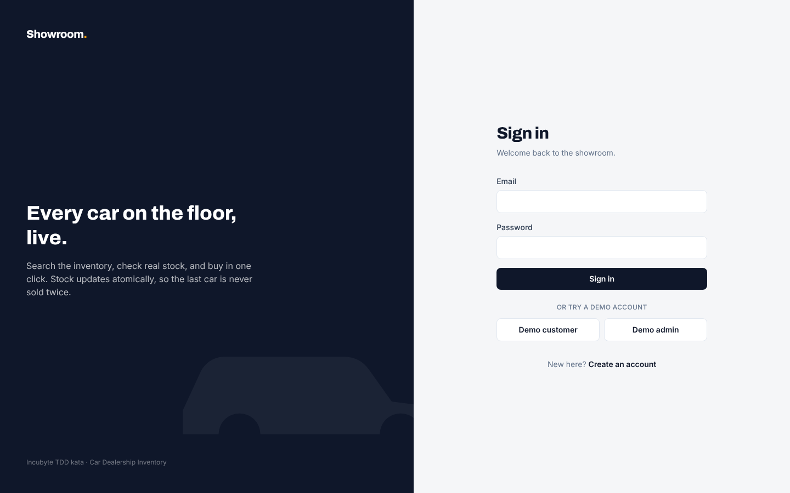 | **Register** 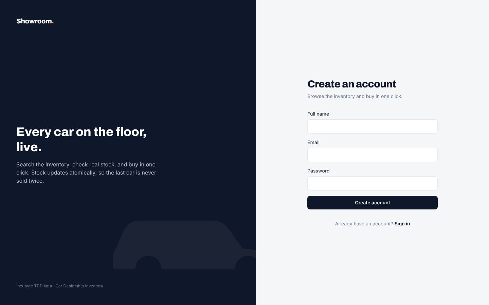 |
| **Search and filter** (text, category, price, stock, sort) 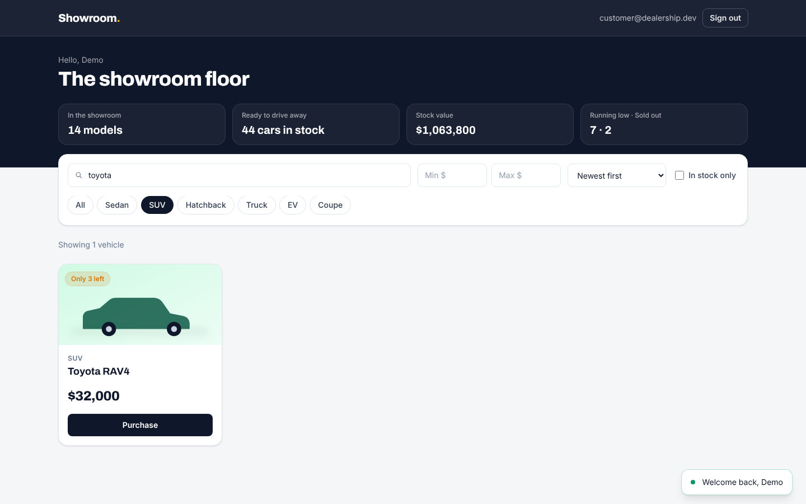 | **Purchase, with confirmation toast** 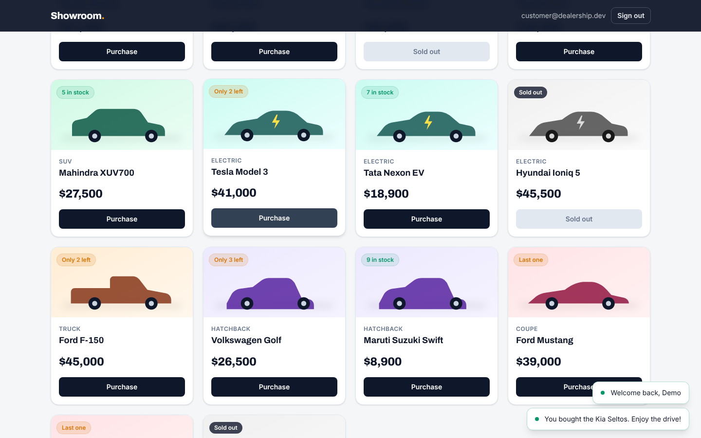 |
| **Admin view**: add, edit, restock, delete on every card 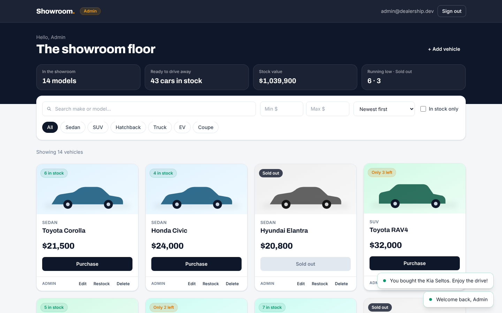 | **Add a vehicle** 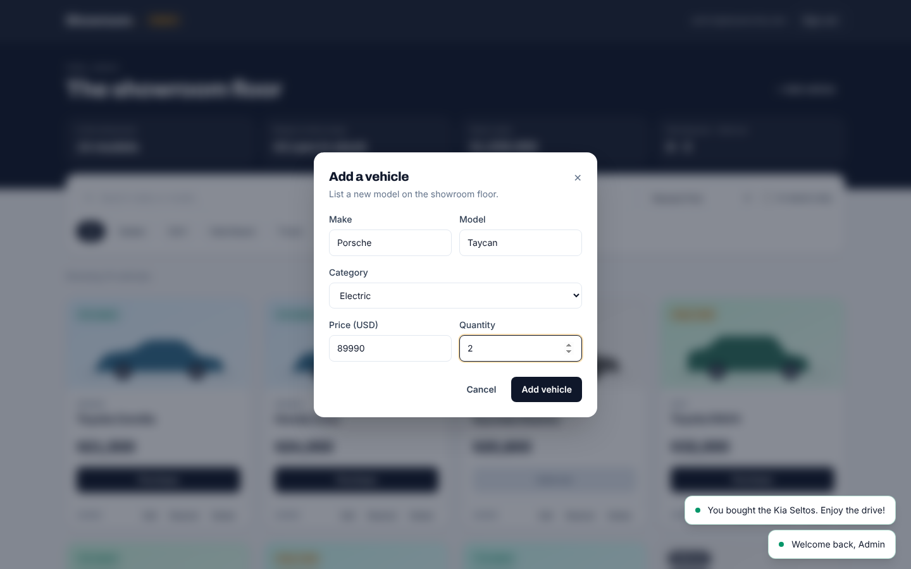 |
| **Restock, with a preview of the new level** 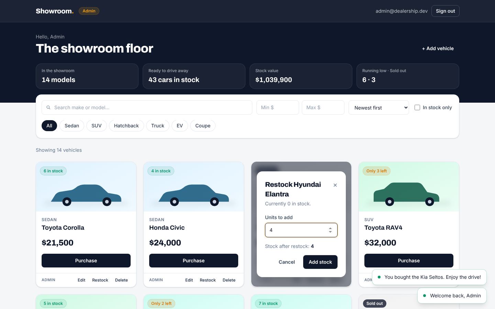 | **Delete confirmation** 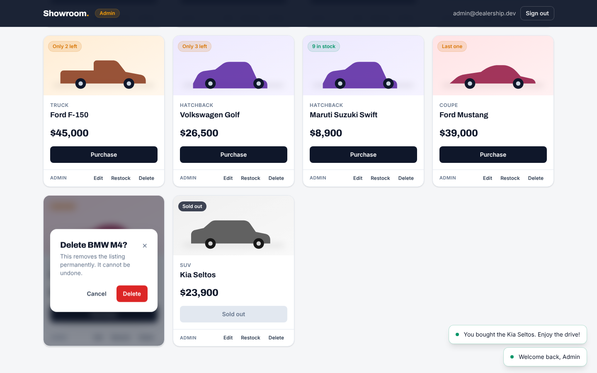 |

<p align="center"><b>Phone (390 px)</b><br>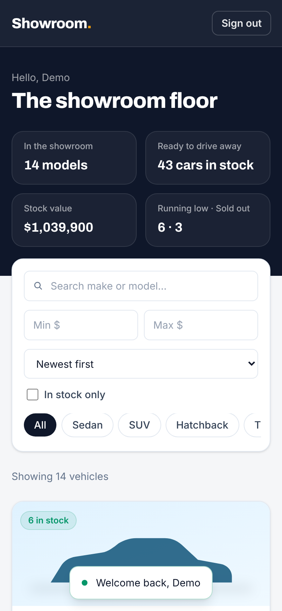</p>

---

## Deployment

The layout is a static SPA on **Vercel**, the API on **Render** and PostgreSQL on **Neon**.

1. **Neon.** Create a project and a `dealership` database, and copy the **pooled** connection string.
2. **Render (API).** Choose *New → Blueprint* and point it at this repo. [`render.yaml`](render.yaml) configures the service: root `backend`, build `npm ci && npm run build`, start `npm run start:prod` (runs `prisma migrate deploy`, then starts the server) and health check `/api/health`. Then, in the dashboard:
   - Set `DATABASE_URL` to the Neon string, and set `CORS_ORIGIN` to the Vercel URL. `JWT_SECRET` is generated by Render.
   - Seed once from the Render shell. Set `ADMIN_EMAIL` and `ADMIN_PASSWORD` first, optionally with the `DEMO_USER_*` variables, then run `npm run db:seed`.
3. **Vercel (frontend).** Import the repo with root directory `frontend`. Set `VITE_API_URL` to `https://<render-service>.onrender.com/api`, and optionally the `VITE_DEMO_*` variables. [`frontend/vercel.json`](frontend/vercel.json) rewrites every path to `index.html`, so client-side routes survive a page refresh.

No secret is committed. Everything sensitive lives in the hosting dashboards.

> The Render free tier sleeps when idle, so the first request after a while can take around 30 seconds.

---

## Known limitations and future work

- **Sessions.** The token is stored in `localStorage`, and the role is read from the token. The next step is httpOnly cookies with refresh tokens and a per-request user check (see [SECURITY.md](SECURITY.md#known-trade-offs)).
- **Pagination.** The catalogue is returned in full, which is fine for a showroom but not for thousands of vehicles. Cursor pagination would be the next endpoint change.
- **Purchase history.** A purchase only decrements stock. An `orders` table would record who bought what and allow a "My purchases" page.
- **Audit log** of admin actions, and a security panel showing failed logins and rate-limit hits.
- **Vehicle photos.** Cards use generated category artwork. Image uploads to object storage would come next.
- **Rate-limit store** is in memory, so running several instances would need a shared store such as Redis.
- **CI.** Add a GitHub Actions workflow that runs both test suites against a Postgres service container, plus a gitleaks secret scan.
